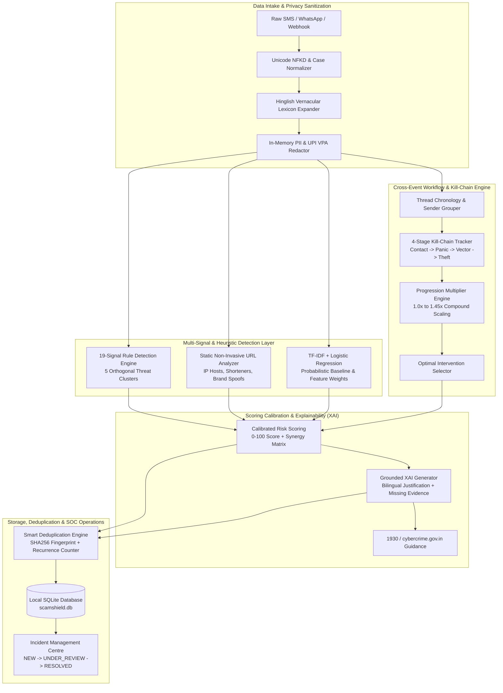
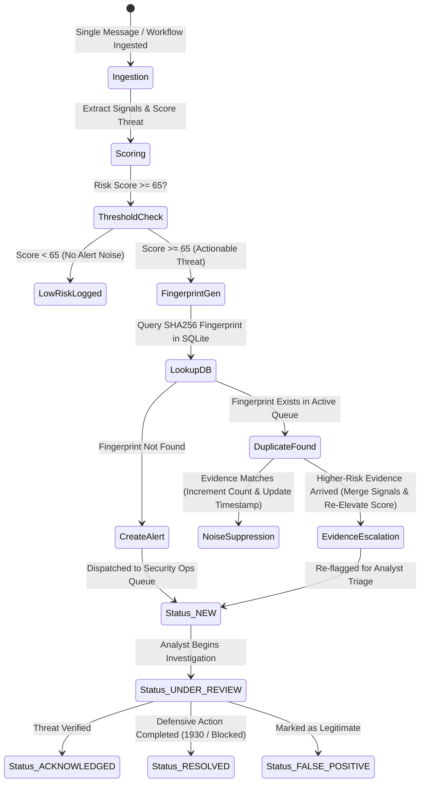

# ScamShield AI - System Architecture Specification
## RAKSHAM AI Cybersecurity Hackathon | IIT Delhi (Problem Statement 2: AI-Driven Scam Pattern Recognition)

---

## 1. High-Level System Architecture & Overview

ScamShield AI is an explainable, multi-signal cyber scam pattern recognition and early-warning platform engineered specifically for the Indian digital payment and mobile ecosystem (UPI payments, banking KYC, utility disconnection scams, fake APK malware, and digital arrest extortion).

The platform decouples detection into specialized, deterministic and probabilistic layers executing locally with sub-2ms latency:

1. **Ingestion & Privacy Sanitization Layer**: Sanitizes incoming communications (SMS, WhatsApp, web hooks), decomposes Unicode, expands colloquial Hinglish vocabulary, and redacts sensitive PII (phone numbers, account numbers, and UPI VPAs).
2. **Multi-Signal Decomposition Layer**: 19 specialized deterministic detectors operating across 5 orthogonal threat clusters, coupled with non-invasive static URL heuristics.
3. **Machine Learning Probabilistic Baseline**: Sublinear TF-IDF feature extraction coupled with L2-regularized Logistic Regression for secondary score attribution.
4. **Calibrated Risk & Synergy Scoring Engine**: Computes normalized 0–100 risk scores using diminishing intra-cluster marginal weights ($0.40\times$), orthogonal multi-cluster synergy bonuses ($+12$ to $+28$), and mitigating benign offsets ($-45$ to $-80$).
5. **Cross-Event Workflow Correlation Engine (Signature Innovation)**: Reconstructs multi-stage attack campaigns chronologically, tracks 4-stage kill-chain progression, calculates compound multipliers ($1.0\times$ to $1.45\times$), and identifies optimal intervention points.
6. **Explainable AI (XAI) & Action Generator**: Produces grounded bilingual (English + Hindi) justifications, itemized score contributions, missing evidence checklists, and 1930 Cybercrime Helpline protocols.
7. **Persistent Security Operations (SOC) & Alert Management**: SQLite-backed incident queue with SHA256 campaign fingerprinting, automated noise deduplication, dynamic evidence escalation, and full analyst triage lifecycle support.

---

## 2. End-to-End System Pipeline Diagram



---

## 3. Core Component Modules & Code Structure

| Component Module | File Location | Architectural Responsibility |
|---|---|---|
| **System Configuration** | [`src/config.py`](file:///c:/Users/welle/.gemini/antigravity-ide/scratch/IITD/src/config.py) | Threat cluster definitions, signal weights, synergy bonuses, entity catalogs, and Indian emergency numbers. |
| **Preprocessing & Privacy** | [`src/preprocessing.py`](file:///c:/Users/welle/.gemini/antigravity-ide/scratch/IITD/src/preprocessing.py) | Unicode normalization, Hinglish phrase mapping, entity parsing, and PII masking. |
| **URL & Domain Analyzer** | [`src/url_analyzer.py`](file:///c:/Users/welle/.gemini/antigravity-ide/scratch/IITD/src/url_analyzer.py) | Non-invasive lexical URL analysis (IP addresses, shorteners, punycode, lookalike bank domains). |
| **Signal Extractor** | [`src/signal_extractor.py`](file:///c:/Users/welle/.gemini/antigravity-ide/scratch/IITD/src/signal_extractor.py) | 19 deterministic regex and heuristic signal detectors mapped across 5 threat clusters. |
| **Scam Classifier Baseline** | [`src/classifier.py`](file:///c:/Users/welle/.gemini/antigravity-ide/scratch/IITD/src/classifier.py) | TF-IDF vectorizer + Logistic Regression model providing feature attribution weights. |
| **Workflow Correlation Engine** | [`src/workflow_engine.py`](file:///c:/Users/welle/.gemini/antigravity-ide/scratch/IITD/src/workflow_engine.py) | Signature feature: cross-event multi-stage sequence correlation, kill-chain tracker, and optimal intervention logic. |
| **Risk Scoring Engine** | [`src/risk_scoring.py`](file:///c:/Users/welle/.gemini/antigravity-ide/scratch/IITD/src/risk_scoring.py) | 5 threat clusters, diminishing marginal weights ($0.40\times$), multi-cluster synergy bonuses, and benign mitigations. |
| **Explainable AI (XAI)** | [`src/explanations.py`](file:///c:/Users/welle/.gemini/antigravity-ide/scratch/IITD/src/explanations.py) | Grounded bilingual explanations (English/Hindi), itemized factors, missing evidence checklists, and 1930 advice. |
| **Storage & Persistence** | [`src/storage.py`](file:///c:/Users/welle/.gemini/antigravity-ide/scratch/IITD/src/storage.py) | Local SQLite persistence (`data/scamshield.db`) managing alert records, metrics, and audit logs. |
| **Alert Management** | [`src/alert_manager.py`](file:///c:/Users/welle/.gemini/antigravity-ide/scratch/IITD/src/alert_manager.py) | Smart deduplication, SHA256 campaign fingerprinting, evidence escalation, and SOC triage lifecycle. |
| **Evaluation Suite** | [`src/evaluation.py`](file:///c:/Users/welle/.gemini/antigravity-ide/scratch/IITD/src/evaluation.py) | Automated empirical evaluation computing precision, recall, F1, FPR, confusion matrix, and latency. |

---

## 4. Threat Cluster Architecture & Compounding Synergy Matrix

The scoring engine organizes signals into 5 orthogonal threat dimensions to prevent double-counting while capturing compound risk:

```
┌────────────────────────────────────────────────────────────────────────┐
│                       5 THREAT CLUSTERS                                │
├───────────────────┬───────────────────┬────────────────────────────────┤
│ Cluster Name      │ Base Weight Range │ Included Signals               │
├───────────────────┼───────────────────┼────────────────────────────────┤
│ 1. AUTHORITY      │ 28.0 - 35.0 pts   │ Impersonation, Digital Arrest, │
│                   │                   │ Legal Threats, Electricity     │
├───────────────────┼───────────────────┼────────────────────────────────┤
│ 2. COERCION       │ 16.0 - 24.0 pts   │ Extreme Urgency, Suspension,   │
│                   │                   │ Courier Customs Extortion      │
├───────────────────┼───────────────────┼────────────────────────────────┤
│ 3. VECTOR         │ 18.0 - 30.0 pts   │ Suspicious URL, Fake APK,      │
│                   │                   │ Remote Access, Channel Hopping │
├───────────────────┼───────────────────┼────────────────────────────────┤
│ 4. EXFILTRATION   │ 22.0 - 38.0 pts   │ OTP Harvesting, UPI PIN Trap,  │
│                   │                   │ Lottery/Job Scams, Hinglish    │
├───────────────────┼───────────────────┼────────────────────────────────┤
│ 5. BENIGN         │ -45.0 - -80.0 pts │ Bank Receipts, Advisories,     │
│                   │                   │ Delivery PINs, 1800 Helplines  │
└───────────────────┴───────────────────┴────────────────────────────────┘
```

### Calibration Formula:
1. **Cluster Raw Score**:
   $$\text{ClusterScore}(C) = \text{BaseWeight}_{\max} + 0.40 \times \sum_{i=2}^k \text{BaseWeight}_i$$
2. **Synergy Bonus Matrix**:
   - `AUTHORITY` + `EXFILTRATION`: $+16\text{ pts}$ (e.g. Bank official asking for OTP).
   - `COERCION` + `VECTOR` + `EXFILTRATION`: $+22\text{ pts}$ (e.g. Account suspended, install APK, enter PIN).
   - `AUTHORITY` + `COERCION` + `VECTOR` + `EXFILTRATION`: $+28\text{ pts}$ (Full multi-vector attack).
3. **Composite Risk Score**:
   $$\text{Risk} = \text{Clamp}_{0}^{100}\left(\sum \text{ClusterScore} + \text{SynergyBonus} - \text{BenignOffset}\right)$$

---

## 5. Alert Lifecycle & Smart Deduplication State Machine



---

## 6. Privacy, Security & Responsible AI Safeguards

1. **Strict Data Minimization**: All PII (Indian 10-digit mobile numbers, UPI Virtual Payment Addresses, account numbers) is masked in-memory before scoring or logging.
2. **Non-Invasive Analysis**: URL evaluation parses domain syntax in memory (IP patterns, punycode, brand keywords) without performing outbound network connections to attacker infrastructure.
3. **Deterministic Explainability**: XAI reasoning is generated from verifiable rule activations and explicit missing-evidence criteria, eliminating AI hallucination risks.
4. **Advisory Decision Support**: ScamShield AI provides intelligence and recommended intervention steps; it does not autonomously freeze user accounts or execute destructive actions.
5. **National Cybercrime Reporting Portal Integration**: Automatically generates structured complaint summaries formatted for India's **1930 Helpline** and **cybercrime.gov.in**.
